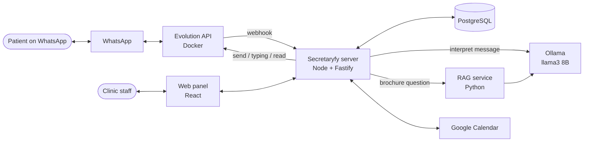

# Secretaryfy

A WhatsApp assistant for a clinic. It answers patients' questions from the clinic's brochure, books, reschedules and cancels appointments on the clinic's Google Calendar, and reminds patients the day before. Staff follow every conversation in a web panel and can take over at any time. The demo clinic is the fictional **DentalSafe**.

**Stack:** Node 24 + TypeScript · Fastify 5 · PostgreSQL 17 + Drizzle · React 19 + Vite 8 · Python 3.14 RAG service (FastAPI, Chroma, BM25) · Ollama (`llama3` 8B, local) · Evolution API v2.3.7 · Google Calendar API
**Status:** working prototype, run locally against a real WhatsApp number and Google Calendar.

## Documentation map

| Document | Answers |
|---|---|
| [Product](product.md) | What the system does, for whom, main journeys, glossary |
| [Business rules](business-rules.md) | Every rule the system enforces (scheduling, reminders, anti-ban, panel) and where it lives |
| [Architecture](architecture.md) | Components, code layout, front-end, cross-cutting concerns, risks |
| [Message pipeline](message-pipeline.md) | The core flow: from a WhatsApp message to the reply, end to end |
| [API](api.md) | Server routes: webhook, panel API, real-time events |
| [Data model](data-model.md) | Tables, relationships and lifecycles |
| [Integrations](integrations.md) | Evolution API, Google Calendar, Ollama, RAG service |
| [Development](development.md) | Running locally, testing, evaluating, common tasks |
| [Decisions](decisions/README.md) | Architecture decision records (ADRs) |

Feature specs (in Portuguese) live in [`specs/`](../specs): one folder per feature, 001 to 006, each with `spec.md`, `plan.md`, `research.md`, `data-model.md`, `contracts/` and `quickstart.md`. They hold the detailed reasoning behind each feature; these docs summarize the result and link to them when the detail matters.

## One-screen overview

- Every message the clinic number sends or receives is stored and shown live in the panel.
- A small local model (`llama3` 8B) only **interprets** messages; deterministic code decides, checks the calendar and writes the replies ([ADR 0002](decisions/0002-state-machine-with-local-llm-as-interpreter.md)).
- Brochure questions go to the RAG service reused from the RagLab project ([ADR 0001](decisions/0001-reuse-raglab-as-separate-service.md)).
- Every outgoing WhatsApp message passes one anti-ban gate ([ADR 0003](decisions/0003-single-send-gate.md)).
- Google Calendar is the source of truth for appointments.
- The assistant always writes in English, and the panel is in English. Code comments and specs are in Portuguese.

## Open questions

- [ ] Where will this run in production? There is no Dockerfile for the server, no CI and no deploy setup yet. Several components assume a single process ([ADR 0007](decisions/0007-single-process-in-memory-coordination.md)).
- [ ] `ANTHROPIC_API_KEY` is required at startup and `@anthropic-ai/sdk` is a dependency, but nothing calls the Claude API. Is a Claude integration planned, or should both be removed?
- [ ] `package.json` describes the project as "assistant for sending emails and Google Calendar scheduling". Is email still in scope?
- [ ] Is the system meant to serve one clinic per deployment (as today: one calendar, one number, one operator password), or several?
- [ ] How long should conversations and messages be kept (LGPD retention)? Today they are kept until the number is disconnected or the operator deletes them.
- [ ] Should the assistant answer in Portuguese? Today it always answers in English, and Portuguese questions can retrieve the wrong brochure section.

---
Last updated: 2026-10-31 (90f9c7e)
