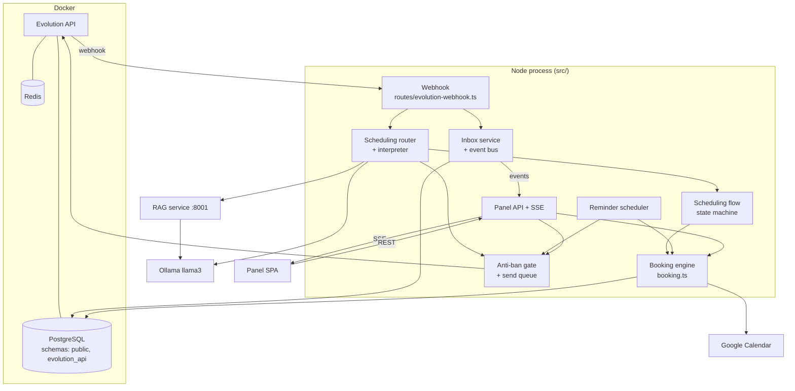
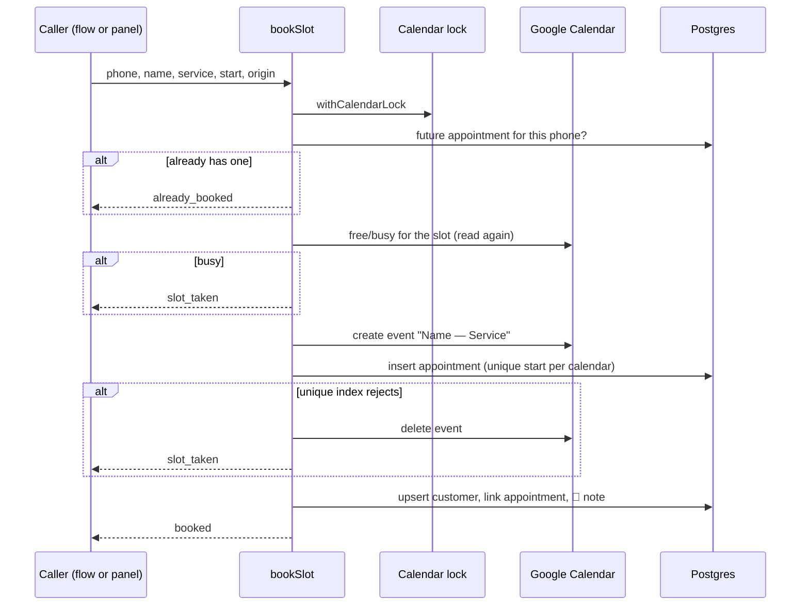

# Architecture

## Stack

| Layer | Technology | Version | Notes |
|---|---|---|---|
| Server runtime | Node.js + TypeScript | Node 24, TS 7 | ES modules, run with `tsx` in development |
| HTTP | Fastify | 5 | Webhook, panel API, SSE, serves the built panel |
| Database | PostgreSQL + Drizzle ORM | Postgres 17, Drizzle 0.45 | Migrations in [`drizzle/`](../drizzle) |
| Validation | Zod | 4 | Env vars, request bodies, interpreter output |
| Dates | Luxon | 3.7 | All scheduling math in the calendar's time zone |
| Panel | React + Vite | React 19, Vite 8 | Plain CSS, no component library, in [`web/`](../web) |
| Message interpreter | Ollama `llama3` (8B, Q4) | — | Local; JSON-schema-constrained output |
| Brochure answers (RAG) | Python, FastAPI, LangChain, Chroma, rank-bm25 | Python 3.14 | Separate service in [`rag/`](../rag), copied from RagLab |
| WhatsApp | Evolution API | v2.3.7 | Docker; Baileys-based (WhatsApp Web protocol) |
| Calendar | Google Calendar API (`googleapis`) | 186 | OAuth with offline access |
| Tests | `node:test` + PGlite | — | In-memory Postgres; fake calendar; no network |

Versions come from [package.json](../package.json), [docker-compose.yml](../docker-compose.yml) and [rag/requirements.txt](../rag/requirements.txt).

## Components



Four processes run on the clinic's machine: the Node server, the Python RAG service, Ollama, and the Docker stack (Postgres, Redis, Evolution API). The Node server is the only one the panel and the Evolution API talk to.

## Code layout

```
src/
  config/       env validation (zod), AES-GCM encryption and HMAC signing
  db/           Drizzle schema and client
  modules/      business logic, one folder per domain, no HTTP
    antiban/    the send gate, queue, limits, pacing, loop/opt-out/link rules, breaker
    auth/       operator password check, session token, login rate limit
    customers/  customer registry
    google/     OAuth, calendar connection, CalendarGateway (googleapis wrapper)
    inbox/      conversations and messages, pause, event bus, JSON presenters
    rag/        HTTP client of the RAG service
    reminders/  reminder scheduler and the label shown in the panel
    scheduling/ rules, free-time math, interpreter, router, state machine, booking engine, replies
    whatsapp/   Evolution API events parser, sending, instance/QR, message handler
  routes/       Fastify plugins; also where process-wide instances are wired (inbox.ts, calendar.ts, scheduling.ts)
  test/         test setup: env, PGlite database, fake calendar, clock
web/src/        panel: App shell, pages/, components/, api.ts, useEvents.ts
rag/            Python RAG service and its evaluation bench (own README)
scripts/        simulate a customer, seed a conversation, evaluate scheduling with the real model
specs/          feature specs 001–006 (Portuguese)
drizzle/        SQL migrations
```

Modules receive their dependencies as arguments (`createX({ ... })`), so tests swap the database, the calendar, the clock and the WhatsApp sender. The real instances are created once in `src/routes/inbox.ts`, `src/routes/calendar.ts` and `src/routes/scheduling.ts` and shared by the webhook, the panel API and the reminder scheduler. [index.ts](../src/index.ts) registers the routes and starts the scheduler.

## Main flows

- **Incoming message → reply:** the core of the system, documented end to end in [message pipeline](message-pipeline.md).
- **Booking (assistant or panel):** both call `bookSlot` in [booking.ts](../src/modules/scheduling/booking.ts):



- **Reminders:** a `setInterval` in the server process ticks every minute ([scheduler.ts](../src/modules/reminders/scheduler.ts)). Each tick takes pending reminders whose appointment is within 24 h, re-syncs each with Google, checks the gate without recording anything (`assistantBlockReason`), and only then sends.

## Front-end

The panel is a single-page React app in [`web/src`](../web/src). In development Vite serves it on :5173 and proxies `/api` to :3000, keeping one origin for the session cookie. In production `npm run build` writes `web/dist/` and the Fastify server serves it, with `index.html` as the fallback for any non-API GET ([panel-static.ts](../src/routes/panel-static.ts)).

- **Navigation:** hash routes, no router library. [App.tsx](../web/src/App.tsx) maps `#/` (conversations), `#/appointments`, `#/connection`, `#/calendar`, `#/customers`; the old Portuguese hashes (`#/conexao`, `#/agenda`, `#/clientes`) still work. `#/?c=<conversationId>` opens a conversation, which is how the Appointments and Customers pages link to it. The app starts by calling `GET /api/session`: 503 shows the "panel disabled" page, 401 the login page, 200 the shell.
- **State:** no global store. Each page loads its own data through [api.ts](../web/src/api.ts) and keeps it in local state. The shell holds only the WhatsApp connection and the protection state, shown in the top bar and the banner.
- **Real time:** [useEvents.ts](../web/src/useEvents.ts) opens one `EventSource` on `/api/events` and fans events out through `EventsContext`; pages subscribe with `useInboxEvents`. Events either carry the changed object (`message.created`, `conversation.updated`, `connection.updated`…) or just say "reload" (`appointments.updated`, `customers.updated`). When the stream reconnects after a drop, a synthetic `reconnected` event tells every page to reload, so nothing is missed.
- **API client:** `fetch` wrappers in [api.ts](../web/src/api.ts) with typed responses and an `ApiError` carrying status and error code. Any 401 calls the handler registered by `App`, which returns to the login page. A `409 risk_confirmation_required` on send opens [RiskDialog.tsx](../web/src/components/RiskDialog.tsx); confirming resends with `confirmRisk`.
- **Shared components:** [Composer.tsx](../web/src/components/Composer.tsx) (Enter sends on desktop, newline on mobile), [MessageBubble.tsx](../web/src/components/MessageBubble.tsx) (status, block reason, retry), [NewAppointment.tsx](../web/src/components/NewAppointment.tsx) (phone lookup → name → service → day/time grids), [ProtectionBanner.tsx](../web/src/components/ProtectionBanner.tsx). Text helpers in [format.ts](../web/src/format.ts).
- **Layout:** responsive down to 375 px; on phones the conversation list and the open conversation are separate screens and the tab bar scrolls horizontally. All styles are in [styles.css](../web/src/styles.css).

## Cross-cutting concerns

- **Authentication:** one operator password; signed HTTP-only cookie (12 h); every `/api/*` route except `/api/session` requires it. Bodies must be JSON (415 otherwise), which also blocks simple cross-site form posts. See [BR-PNL-01](business-rules.md#br-pnl-01--one-shared-password). The Evolution webhook is authenticated by a token in the URL, compared in constant time. The Google OAuth `state` is HMAC-signed and expires in 10 min.
- **Secrets at rest:** the Google refresh token is encrypted with AES-256-GCM using `APP_SECRET` ([crypto.ts](../src/config/crypto.ts)).
- **Configuration:** every env var is validated at startup with zod ([env.ts](../src/config/env.ts)); an invalid value stops the server with a readable message.
- **Logging:** Fastify's pino logger, pretty in development. The session cookie is redacted. Logs are in Portuguese.
- **Time zones:** all scheduling uses the selected Google Calendar's time zone, re-checked against Google at startup.
- **Error handling toward the patient:** the patient never sees an error; failures become the "unavailable" message or a hand-off to staff, and the cause goes to the log.
- **Languages:** assistant messages and the panel are in English; code comments, logs and specs are in Portuguese.

## Decisions

See [decisions/](decisions/README.md):

1. [Reuse RagLab as a separate Python service](decisions/0001-reuse-raglab-as-separate-service.md)
2. [Deterministic state machine; the local LLM only interprets](decisions/0002-state-machine-with-local-llm-as-interpreter.md)
3. [One gate for every outgoing WhatsApp message](decisions/0003-single-send-gate.md)
4. [Unofficial WhatsApp connection through the Evolution API](decisions/0004-evolution-api-unofficial-whatsapp.md)
5. [Google Calendar as the source of truth](decisions/0005-google-calendar-source-of-truth.md)
6. [The appointment belongs to the phone, with one booking engine](decisions/0006-appointment-belongs-to-phone.md)
7. [Single process with in-memory coordination](decisions/0007-single-process-in-memory-coordination.md)
8. [Reminders only inside the 24 h window](decisions/0008-reminder-only-inside-24h-window.md)

## Risks and technical debt

- **Single process only.** The calendar lock, send queue, debouncer, event bus, login limiter and reminder scheduler live in memory ([ADR 0007](decisions/0007-single-process-in-memory-coordination.md)). Two server instances could double-book or exceed the anti-ban limits.
- **Ban risk.** The unofficial connection can get the number banned regardless of the gate ([ADR 0004](decisions/0004-evolution-api-unofficial-whatsapp.md)).
- **Local model latency.** The first message after Ollama unloads the model is slow. The interpreter keeps it loaded for 30 min (`keep_alive`), and the RAG timeout is 30 s to cover cold starts.
- **Unused Claude dependency.** `@anthropic-ai/sdk` and a required `ANTHROPIC_API_KEY` with no caller.
- **No deployment setup.** No Dockerfile for the server or the RAG service, no CI, no backups. Everything assumes one developer machine (e.g. Postgres on port 5434).
- **English-only retrieval.** The RAG synonyms are English, so Portuguese questions can retrieve the wrong section.
- **Panel phone input** can't express North American numbers ([BR-SCH-12](business-rules.md#br-sch-12--panel-bookings-use-the-same-engine-and-send-nothing)).
