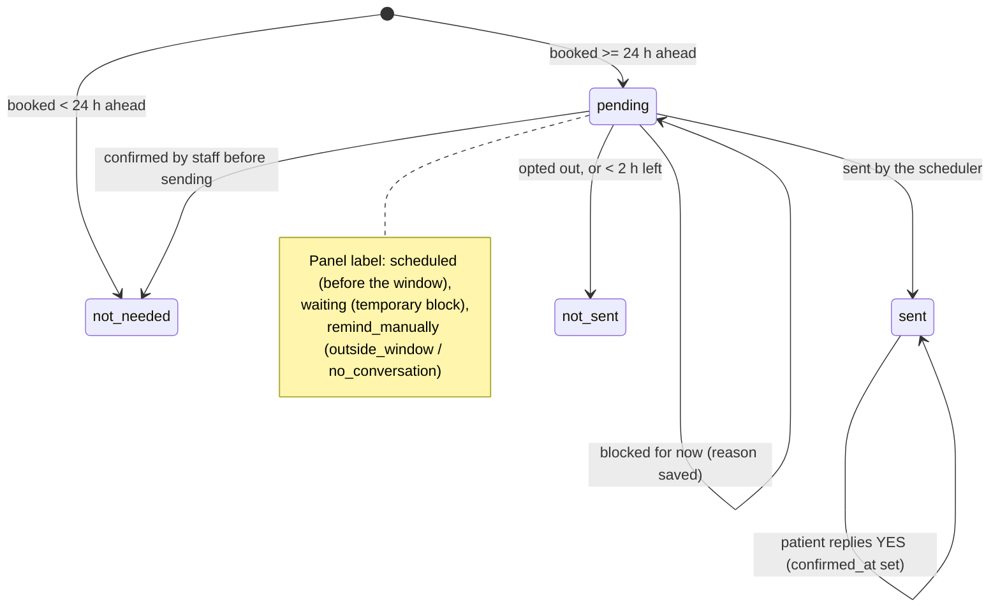

# Business rules

Rules the system enforces, grouped by domain. Numbers in parentheses are the defaults; the operator changes booking rules in the panel, and anti-ban and reminder limits are set through environment variables ([development](development.md#environment-variables)). Requirement IDs such as `FR-015` refer to the feature specs in [`specs/`](../specs).

## Conversations and the assistant

### BR-CNV-01 · Only one-to-one text messages get an answer
Audio, images, stickers and other media are stored and shown in the panel but never sent to the assistant. Group chats are ignored.
- **Where:** [evolution.ts](../src/modules/whatsapp/evolution.ts) (`parseEvolutionEvent`); [evolution-webhook.ts](../src/routes/evolution-webhook.ts)

### BR-CNV-02 · Each WhatsApp event is recorded and answered once
The same event delivered twice, even after a restart, is stored once and answered once.
- **Where:** unique `messages.wa_message_id`, insert with `on conflict do nothing` in [inbox/repository.ts](../src/modules/inbox/repository.ts)

### BR-CNV-03 · Consecutive messages get one reply
The assistant waits for 4 s of silence (`ANTIBAN_DEBOUNCE_MS`) and answers everything the patient sent since its last reply in one go.
- **Where:** [debounce.ts](../src/modules/antiban/debounce.ts), `debouncer` in [evolution-webhook.ts](../src/routes/evolution-webhook.ts)

### BR-CNV-04 · A message goes to scheduling or to the brochure
Every message is interpreted first. Booking-related intents (book, availability, cancel, reschedule, my appointment) and any message during a scheduling session go to scheduling; the rest goes to the brochure (RAG). A brochure question in the middle of a booking is still answered by the brochure.
- **Where:** [router.ts](../src/modules/scheduling/router.ts); detail in [message pipeline](message-pipeline.md)

### BR-CNV-05 · Brochure answers are short and honest
At most 3 messages per reply, split by paragraph (or by sentence when one long block). When the brochure doesn't have the answer, the assistant says "I don't have that information right now." instead of guessing. The assistant writes in the clinic language (`CLINIC_LANGUAGE`, English by default); panel text stays English.
- **Where:** `splitReply` and `MAX_PARTS` in [handle-message.ts](../src/modules/whatsapp/handle-message.ts); `NO_ANSWER` in [rag/config/languages/en.yaml](../rag/config/languages/en.yaml), the system prompt in [rag/config/prompts.yaml](../rag/config/prompts.yaml) (shared by every language), with the clinic data in [rag/config/clinic.yaml](../rag/config/clinic.yaml)

### BR-CNV-06 · The operator takes over a conversation by writing in it
Sending a message from the panel pauses the assistant in that conversation and cancels any reply it was about to send. It stays silent until the operator clicks **Resume**. Pause is checked before the assistant thinks and again right before sending.
- **Where:** `cancelPendingReply` in [evolution-webhook.ts](../src/routes/evolution-webhook.ts); `isPaused` checks in [handle-message.ts](../src/modules/whatsapp/handle-message.ts); `superseded` in [gate.ts](../src/modules/antiban/gate.ts)

### BR-CNV-07 · When the assistant is down, the patient is told once
If the RAG service fails or exceeds `RAG_TIMEOUT_MS` (30 s), the patient gets a short "unavailable" message (one of several variants, never the same one twice in a row). If the interpreter (Ollama) fails outside a booking, the message goes to the brochure; inside a booking, the patient gets the unavailable message.
- **Where:** `createRagAnswerer` in [handle-message.ts](../src/modules/whatsapp/handle-message.ts); `InterpreterUnavailable` in [router.ts](../src/modules/scheduling/router.ts)

### BR-CNV-08 · Disconnecting the number deletes every conversation
When WhatsApp logs the number out, all conversations and messages are deleted. The operator can also delete them all, or one at a time, from the panel. Appointments, the customer registry and opt-outs survive both.
- **Where:** `loggedOut` branch in [evolution-webhook.ts](../src/routes/evolution-webhook.ts); `DELETE /api/conversations` and `DELETE /api/conversations/:id` in [panel-api.ts](../src/routes/panel-api.ts)

## Scheduling

Booking rules are stored in `scheduling_rules` and edited in the panel (**Calendar**). Defaults: Monday to Friday 09:00–18:00, 60-minute appointments, 2 h minimum notice, 30 days ahead, cancel or reschedule up to 24 h before.

### BR-SCH-01 · Free times come from the rules and the calendar
A time is offered only if it falls within that weekday's opening hours, on the time grid (`grid_minutes`, 15 by default) with room for the treatment's appointment length (ADR 0015), after the minimum notice, within the days-ahead limit, and doesn't overlap **any** busy event on the selected Google Calendar (not just Secretaryfy's own).
- **Where:** `slotsForDay`, `bookingWindow` in [availability.ts](../src/modules/scheduling/availability.ts)
- **Booking window:** the patient (WhatsApp assistant) books only within `maxDaysAhead` (30 by default). The clinic staff (panel, "New appointment") can book up to 365 days ahead (`STAFF_MAX_DAYS_AHEAD`), because a patient who phones may ask for a date months away. Everything else (opening hours, minimum notice, busy calendar, appointment length, grid) is the same for both. The panel calendar shows that whole staff window: a green dot for an open day with free times for the chosen treatment, a red dot for an open day that is fully booked, and no dot when the clinic is closed.
- **Validation of the rules:** at least one open day; start before end; length 15–240 min in multiples of 5; each open day at least one appointment long. `rulesSchema` in [rules.ts](../src/modules/scheduling/rules.ts)

### BR-SCH-02 · Options are bullets, at most 6 per message
Days (written in full, e.g. "quinta-feira, 5 de novembro") and times are offered as bullet lists of up to 6; asking for more shows the next page. The customer picks in free text ("quero sexta", "dia 10", "o primeiro", "o das 9", "quero ver mais"); the code maps the phrase to the offered option, and a bare number still works. A phrase that points to more than one option goes to the model or is asked again.
- **Where:** `PAGE` in [flow/offers.ts](../src/modules/scheduling/flow/offers.ts)

### BR-SCH-03 · Nothing is booked without "yes"
The assistant shows a summary (day, time, name, service) and books only after the patient confirms.
- **Where:** step `confirm_booking` in [flow/dispatch.ts](../src/modules/scheduling/flow/dispatch.ts), summary in [flow/offers.ts](../src/modules/scheduling/flow/offers.ts)

### BR-SCH-04 · Two patients never get the same time
Right before writing, the calendar is read again inside a process-wide lock; a unique index on `(calendar_id, starts_at)` for booked appointments is the second barrier. If the index rejects the insert, the Google event just created is deleted. If the time was taken, the patient (or operator) gets other options.
- **Where:** `bookSlot` in [booking.ts](../src/modules/scheduling/booking.ts); `withCalendarLock` in [lock.ts](../src/modules/scheduling/lock.ts); `appointments_booked_start_uq` in [schema.ts](../src/db/schema.ts)

### BR-SCH-05 · One upcoming appointment per phone number
A phone with a future appointment can't book a second one; the assistant offers to reschedule instead, and the panel returns `already_booked`. The appointment belongs to the phone, not to the conversation ([ADR 0006](decisions/0006-appointment-belongs-to-phone.md)).
- **Where:** `findFutureBooked` in [sessions.ts](../src/modules/scheduling/sessions.ts), used by `bookSlot` in [booking.ts](../src/modules/scheduling/booking.ts)

### BR-SCH-06 · Cancel and reschedule only until the cancellation notice
Within `cancelNoticeMinutes` (24 h) of the appointment, the assistant refuses to cancel or move it and tells the patient the deadline. This notice binds the patient only: the team can cancel at any time (BR-SCH-18).
- **Where:** `Run.tooLate` in [flow/run.ts](../src/modules/scheduling/flow/run.ts)

### BR-SCH-07 · Google Calendar is the source of truth
Before using a stored appointment, it is compared with Google: deleted there means cancelled (with a 📅 note), moved there means the new time is adopted and the reminder recalculated.
- **Where:** `syncAppointment` in [booking.ts](../src/modules/scheduling/booking.ts)

### BR-SCH-08 · A booking dialogue expires after 30 minutes
A scheduling session expires 30 min after the last message. When the patient returns, the booking restarts from the day choice and availability is read again.
- **Where:** `SESSION_TTL_MS` in [sessions.ts](../src/modules/scheduling/sessions.ts)

### BR-SCH-09 · After 2 misunderstood replies, staff take over
On the second consecutive reply the assistant can't understand inside a booking, it tells the patient someone will help, pauses itself in that conversation and flags it **Needs attention**.
- **Where:** `MAX_MISUNDERSTOOD` and `misunderstood()` in [flow/dispatch.ts](../src/modules/scheduling/flow/dispatch.ts)

### BR-SCH-10 · The services are the clinic's treatments, plus the assessment
The services a patient can book are the treatments of the knowledge table that are not marked `bookable: false`, in the table's order, plus two fixed services the clinic turns on or off in the panel (Folheto > Clínica): the follow-up visit (`FollowUp`, "Retorno" / "Follow-up visit"), right after the treatments, and the general assessment (`Assessment`, "General assessment"), always last. The assessment is on by default and the follow-up is off. Each fixed service can carry its own length (`followUpMinutes`, `assessmentMinutes`; empty = the calendar's default). The list is read from the clinic settings on every use, so a change in the panel applies to the next message with no restart. A fixed service that is off is not offered and is never assumed: when the patient has none chosen, the assistant asks for one from the list. The calendar event title and the booking note follow the clinic language at the moment of booking: a fixed service is stored by its key (`FollowUp`, `Assessment`) and the panel shows its label in the viewer's language, while a treatment is stored by its title, the text the clinic wrote. Appointments already made with `Assessment` or `FollowUp` keep their label and length. The assistant picks one of them from the list, by its label: the treatment the patient names in their own words (a focused call reads the conversation and quotes the patient's message; the quote must be in the patient's messages, not the assistant's) or the number of the list shown. A treatment the patient does not name is never the service: the assistant asks for it from the list. A treatment that is not in the list is never the service. The patient can change it at the summary. The stored service is the treatment's key (see BR-SCH-11).
- **Where:** `createKnowledgeCatalog` in [catalog.ts](../src/modules/scheduling/catalog.ts); `formatFor` in [interpret/prompt.ts](../src/modules/scheduling/interpret/prompt.ts) and `validate` in [interpret/validate.ts](../src/modules/scheduling/interpret/validate.ts); [ADR 0014](decisions/0014-booking-services-are-the-clinics-treatments.md)

### BR-SCH-11 · What the calendar event looks like
Title `"<name> — <service>"` (e.g. "Maria Souza — Dental Cleaning"; the service is the stored name: a treatment's key, such as `limpeza-dental`, or `Assessment` / `FollowUp`, see BR-SCH-10); the description holds the WhatsApp number and "Marcado pelo Secretaryfy." (or "Marcado pelo Secretaryfy (painel)." for panel bookings). Every booking, cancellation and reschedule is also written as a 📅 system note in the conversation history.
- **Where:** `bookSlot` in [booking.ts](../src/modules/scheduling/booking.ts); `systemNotes` in [replies.ts](../src/modules/scheduling/replies.ts)

### BR-SCH-12 · Panel bookings use the same engine and send nothing
A booking made by staff runs the same checks as the assistant (rules, free times, lock, one per phone) and sends no WhatsApp message. The phone typed in the panel is normalized: digits only, leading zeros removed, `55` added to 10–11 digit numbers; 12–15 digits are accepted as-is.
- **Where:** `bookSlot` in [booking.ts](../src/modules/scheduling/booking.ts); `normalizePhone` in [phone.ts](../src/modules/scheduling/phone.ts)

> ⚠️ Known limitation: the `+` is dropped before counting, so any 10–11 digit input is read as Brazilian. A US or Canadian number (`+1` plus 10 digits, 11 digits in total) becomes `551…` and can't be booked from the panel. Other countries with 12–15 digits work. See [phone.test.ts](../src/modules/scheduling/phone.test.ts).

### BR-SCH-13 · Replies may be reworded, facts may not

With `HUMANIZE_REPLIES` on (the default) the model may reword a scheduling reply, but only if every time, date, number, name, list line and quoted option survives unchanged (see [message-pipeline](message-pipeline.md#humanizer-humanize_replies-on-by-default)). Otherwise the fixed text is sent. Handoffs are never reworded.

### BR-SCH-14 · What only the team can decide never gets a model answer
When the interpreter classifies a message as `needs_staff` (asks for the doctor, receptionist or manager; says someone authorized a discount or special condition; demands a discount, refund or exception; complains; describes pain, swelling or bleeding; asks for a prescription or medical advice), the reply is a fixed text ("vou chamar alguém da nossa equipe"), the scheduling session is cleared, the conversation is flagged as needing attention and the assistant is paused, with a system note in the panel. For pain, swelling or bleeding (`urgent`) the text also says to go to an emergency room if it gets worse. The brochure model never answers these, so it cannot promise a free service or give medical advice.
- **Where:** `needs_staff` in [router.ts](../src/modules/scheduling/router.ts), `staff` in the replies files

### BR-SCH-15 · Manipulation attempts and off-topic requests get a fixed reply
A message classified as `manipulation` (asks to show, repeat or translate the instructions, tells the assistant to ignore its rules or act as another AI, fake system messages, encoded commands) or as `off_topic` (general knowledge, sports, news, weather, jokes, math or other tasks that have nothing to do with the clinic) gets "Só consigo ajudar com informações da clínica…" and does not reach the brochure model.
- **Where:** `manipulation` and `off_topic` in [router.ts](../src/modules/scheduling/router.ts), `stayOnTopic` in the replies files

### BR-SCH-16 · A repeated brochure answer is sent as one message with a lead
The number protection drops a message identical to one already sent. When a brochure answer repeats a message from the conversation, the repeated parts are left out; only when the whole answer repeats it goes out as a single message starting with a short friendly lead ("Claro!"), each opening is used once per text in the protection window. Only when all three have already been sent for that text is nothing sent, and the error is logged: a known ceiling, not a guarantee.
- **Where:** `unrepeated` in [handle-message.ts](../src/modules/whatsapp/handle-message.ts); `pickVariant` in [gate.ts](../src/modules/antiban/gate.ts)

### BR-SCH-17 · Appointment length per treatment, a time grid and a few natural times
Each treatment may set `appointmentMinutes` (a multiple of 5); without it, and for the general assessment and the follow-up visit when the clinic settings give no length, the default length of the rules applies. The assistant asks for the treatment before it offers days, because the length decides which starts are free (a reschedule keeps the length of the appointment being moved). Start times sit on the grid; the assistant offers up to six **natural** times (the first of the day, the first after a busy block, a start that ends where another begins, and starts that follow the treatment's length from opening), never the whole grid. A time the customer names ("às 14h", "9:45") is checked on the full grid: free, it is chosen; taken or off the opening hours, the assistant says so kindly and offers the three nearest. The model only reads the time (`time`, with a focused second call when the field comes back empty); the code decides. Booking, the calendar event and the stored end use the same length; changing a treatment's length does not touch appointments already made.
- **Where:** [availability.ts](../src/modules/scheduling/availability.ts), [flow/offers.ts](../src/modules/scheduling/flow/offers.ts), [booking.ts](../src/modules/scheduling/booking.ts), [interpret/validate.ts](../src/modules/scheduling/interpret/validate.ts), [ADR 0015](decisions/0015-appointment-length-per-treatment-and-time-grid.md)

## Names and customer registry

### BR-NAM-01 · The assistant asks for the name at a calm moment, at most twice
To a patient with no known name, the assistant adds a request for the name to a greeting or a brochure answer, never after an insult, a complaint, a handoff or a message it did not understand. If the patient keeps going without saying it, it asks once more after 3 messages, and then never again (`name_asks`, `name_asked_at`). Only the interpreter model decides that a message holds a name, with the hint that the assistant just asked; the code keeps the name only if every word of it is written in the patient's messages (accent- and case-insensitive) and the message has no question mark. Messages grouped by the debounce are read together, so "Carla" followed by a question still gives the name. The booking summary shows the name and invites the patient to correct it.
- **Where:** `askName`, `justAsked` and `fromBrochure` in [router.ts](../src/modules/scheduling/router.ts), `nameInText` in [interpret/names.ts](../src/modules/scheduling/interpret/names.ts) and `validate` in [interpret/validate.ts](../src/modules/scheduling/interpret/validate.ts)

### BR-NAM-08 · An insult gets a short, polite reply
A message classified as `rude` (insults the assistant or the clinic and asks nothing) gets "Entendo sua frustração…", with no brochure answer, no offer and no name request.
- **Where:** `rude` in [router.ts](../src/modules/scheduling/router.ts), `calmDown` in the replies files

### BR-NAM-09 · Our greeting does not reach the brochure model
In the history sent to the RAG service, our greeting appears only as its short salutation ("Boa noite!", `salutation` in the replies files), and on the first reply that salutation is appended. The brochure model then neither repeats "Meu nome é Ana…" nor greets a second time ("Oi!"), because it sees a conversation already opened. The greeting follows the time of day, and before 5 a.m. it is still "Boa noite".

### BR-NAM-07 · The first reply opens with a greeting, and the assistant can say its name
The first reply the assistant sends in a conversation (flow or brochure, not a handoff) starts with a greeting for the time of day in the clinic time zone ("Boa tarde! Meu nome é Ana, da Sorriso Pleno."), as its own message. The name comes from the clinic settings the panel edits (`ASSISTANT_NAME` only seeds them on the first start); without a name the greeting only names the clinic. The interpreter model recognises two intents for this, in any wording: `who_are_you` ("Qual seu nome?", "com quem falo?") is answered with the same name, and `greeting` (only a greeting: "oi", "bom dia, tudo bem?") gets our greeting plus "how can I help" and the name request once, without the brochure. The text is ours; the model only classifies. A question mark never makes a message the patient's name. A reply identical to one already sent in the conversation gets a short friendly lead ("Claro!") so the repeated-text protection does not silently drop it; when only some parts of a brochure answer repeat, those parts are left out instead.
- **Where:** `greet` and the `greeting` / `who_are_you` intents in [router.ts](../src/modules/scheduling/router.ts), `greeting` and `myName` in the replies files

### BR-NAM-02 · The WhatsApp profile name is never the patient's name
The known name is the name said in the chat (`conversations.customer_name`), or else the registry name. The profile name is only a label in the panel.
- **Where:** `knownName` in [inbox/service.ts](../src/modules/inbox/service.ts)

### BR-NAM-03 · Confirming a booking registers the customer
A successful booking upserts the customer by phone (one record per phone) and links the appointment to it. The registry has no foreign key to conversations, so it survives deleting conversations or disconnecting the number; a returning patient is recognized by name.
- **Where:** `bookSlot` in [booking.ts](../src/modules/scheduling/booking.ts); `upsert` in [customers/repository.ts](../src/modules/customers/repository.ts)

### BR-NAM-04 · Editing a name updates everything ahead
Renaming a customer in the panel (1–120 characters, trimmed) also renames the conversation, future appointments and the titles of future Google events. If Google fails, the name is saved anyway and the panel warns that the calendar wasn't updated. Past events keep their title.
- **Where:** `PATCH /api/customers/:id` in [panel-customers.ts](../src/routes/panel-customers.ts)

### BR-NAM-05 · Notes are private to the clinic
Customer notes (up to 1,000 characters) appear only in the panel. They never reach the assistant: not the interpreter, not the RAG history, not the known name.
- **Where:** `customers.notes` in [schema.ts](../src/db/schema.ts); validation in [panel-customers.ts](../src/routes/panel-customers.ts)

### BR-NAM-06 · Deleting a customer makes the assistant forget the name
Deleting a record also clears the name from that phone's conversation, so the assistant asks again. Appointments stay on Google Calendar; if the patient books again, they return to the registry.
- **Where:** `DELETE /api/customers/:id` in [panel-customers.ts](../src/routes/panel-customers.ts)

## Reminders

### BR-REM-01 · One reminder per appointment, 24 h to 2 h before
An appointment booked at least 24 h ahead (`REMINDER_LEAD_MINUTES`) gets one reminder, sent between 24 h and 2 h (`REMINDER_CUTOFF_MINUTES`) before it. Appointments booked closer than that get none. Rescheduling recalculates it.
- **Where:** `initialReminderStatus` in [status.ts](../src/modules/reminders/status.ts); [scheduler.ts](../src/modules/reminders/scheduler.ts)

### BR-REM-02 · The reminder never breaks the 24 h window
The reminder goes out only if the patient wrote in the last 24 h. Otherwise, and when the phone has no conversation at all, it shows **Remind manually** in the panel so staff can call and click **Confirm** ([ADR 0008](decisions/0008-reminder-only-inside-24h-window.md)).
- **Where:** `remind()` in [scheduler.ts](../src/modules/reminders/scheduler.ts); `reminderLabel` in [status.ts](../src/modules/reminders/status.ts)

### BR-REM-03 · The reminder passes the anti-ban gate
It's an ordinary assistant message: all [anti-ban rules](#anti-ban-protection) apply. A patient who opted out never gets it (status `not_sent`); a temporary block (paused, limit) makes it wait and retry. It also waits while the patient has an unanswered message or a booking dialogue is open. If 2 h before the appointment it still hasn't gone out, it's marked `not_sent` with the last reason.
A reminder is sent even if staff paused the assistant in that conversation; the protection rules still apply.
- **Where:** `assistantBlockReason` in [gate.ts](../src/modules/antiban/gate.ts); [scheduler.ts](../src/modules/reminders/scheduler.ts)

### BR-SCH-18 · The team sets the length and cancels at any time
The panel can book a length other than the treatment's: `minutes`, an integer from 5 to 480 in steps of 5. The longest it can be is the time from the start to the **start of the next busy interval** on the calendar (an appointment or any other event) or to the closing time of that day, whichever comes first, and never more than 480 minutes. `GET /api/booking/starts` gives that maximum for each start, rounded down to 5. The assistant never changes the length: it always uses the treatment's.

The team can cancel an appointment at any time, with no notice limit (BR-SCH-06 binds the patient only) and without messaging the customer. The row is marked `cancelled_by = staff`, and the conversation history gets "Cancelled from the panel: …". The same cancel function serves the assistant (`cancelled_by = customer`) and the panel, in `booking.ts`.

### BR-SCH-19 · Which services the clinic offers is answered from the catalog
A question that asks which services or treatments the clinic offers or can book ("quais serviços vocês têm?", "o que vocês fazem?") is read as `list_services`. The answer is a fixed text built from the catalog: every bookable treatment, in the table's order, then the follow-up visit if the clinic offers it, then the general assessment last if it is offered, followed by a short offer to book one. No model writes it and no brochure answer is used, so it cannot leave a treatment out or invent one. It does not start a booking: the next "quero marcar a limpeza" does. A question about one treatment, its price or how it works is still a brochure question.
- **Where:** `list_services` in [intents.ts](../src/modules/scheduling/intents.ts) and [interpret/prompt.ts](../src/modules/scheduling/interpret/prompt.ts); `servicesList` in [replies.pt.ts](../src/modules/scheduling/replies.pt.ts) and [replies.en.ts](../src/modules/scheduling/replies.en.ts); the branch in [router.ts](../src/modules/scheduling/router.ts)

### BR-SCH-20 · A weekend question says which days the clinic opens first
"Vocês atendem no fim de semana?" is read as a weekend question (`weekday: weekend`). The answer names the open weekend days first, then the closed ones, then offers the next dates with free times: "Atendemos aos sábados. Aos domingos estamos fechados. Estes são os próximos sábados com horário livre:" followed by up to 6 dates. Both days open: "Atendemos aos sábados e domingos", and the next dates of both. Both days closed: the closed-day text with the closest open days. Every date comes from the weekly hours and the calendar in code; the list is saved as the `choose_day` options, so "quero sábado" or "o primeiro" picks one of them.
- **Where:** `offerWeekend` in [flow/offers.ts](../src/modules/scheduling/flow/offers.ts); `weekendOpen` in [replies.pt.ts](../src/modules/scheduling/replies.pt.ts) and [replies.en.ts](../src/modules/scheduling/replies.en.ts); tests in [flow/weekend.test.ts](../src/modules/scheduling/flow/weekend.test.ts)

### BR-SCH-21 · A part of the day filters the times and never repeats the page
"De manhã", "à tarde" or "à noite" offers only the free times of that part of the day (morning from 05:00, afternoon from 12:00, evening from 18:00, the split of `dayPeriod`). When the day has none in that part, the assistant says so and offers the nearest free times: the first ones after the start of the part, or the last ones of the day when none come later. A request for more times that would show the page already on screen gets the rest of the day, never the same list again.
- **Where:** `offerPeriod` and `periodOfScreen` in [flow/offers.ts](../src/modules/scheduling/flow/offers.ts); `slotsInPeriod` and `slotsNearPeriod` in [flow/period.ts](../src/modules/scheduling/flow/period.ts); `dayPeriod` in [replies.ts](../src/modules/scheduling/replies.ts)

### BR-SCH-22 · A date the customer names is kept
- A date written in the message ("dia 25", "18/11", "25 de dezembro") beats a weekday named in the same message. A bare weekday becomes the next day with that name only when no date is written.
- A written date replaces the date the model computed. When the written date is not one of the offered days, the option number the model picked is dropped. A date the model gives with no day written in the message is dropped too, and the day on screen counts.
- A date after the booking window (`maxDaysAhead`, 30 by default) gets the too-far reply with the closest open days.
- **Where:** `validate` in [interpret/validate.ts](../src/modules/scheduling/interpret/validate.ts); `findExplicitDatesInText` in [dates.ts](../src/modules/scheduling/dates.ts); `applyWhen` in [understanding/resolve.ts](../src/modules/scheduling/understanding/resolve.ts); `tooFar` in [flow/offers.ts](../src/modules/scheduling/flow/offers.ts)

### BR-SCH-23 · A yes or no is read by a focused agreement call
A confirmation (booking, cancellation, reschedule, offer to reschedule) answered with the bare subject of the question ("cancelar", "pode sim") is read again by a focused call that sees only that message: `agree` is yes, `refuse` is no, and `neither` or a failed call changes nothing. A cancellation without a clear answer becomes `unclear`, so nothing is cancelled on a guess. The assistant never answers yes without an `agree`. If the message names a day, time or part of the day, it is a change request and the call is not made.
- **Where:** `createAgreementReader` in [understanding/agreement.ts](../src/modules/scheduling/understanding/agreement.ts); `applyAgreement` in [understanding/resolve.ts](../src/modules/scheduling/understanding/resolve.ts); the `topicOnly` branch in [router.ts](../src/modules/scheduling/router.ts)

### BR-SCH-24 · A time chosen with an upcoming appointment is a reschedule
When the phone already has a future appointment, the time the patient chooses moves that appointment: the assistant asks for the reschedule confirmation (`confirm_reschedule`), or says the deadline has passed (BR-SCH-06). It never books a second appointment.
- **Where:** `selectSlot` and `switchUpcoming` in [flow/offers.ts](../src/modules/scheduling/flow/offers.ts); `confirm_reschedule` in [flow/dispatch.ts](../src/modules/scheduling/flow/dispatch.ts)

### BR-SCH-25 · No em dash in the assistant's texts
The scheduling replies in both languages have no em dash or en dash. The humanizer's rewrite prompt forbids them, and `guardRewrite` refuses a rewrite that adds one unless the fixed text already had it. Brochure answers come from the RAG service and are not checked by this rule. Calendar titles and panel labels are not assistant texts.
- **Where:** `guardRewrite` and the rewrite prompt in [humanize.ts](../src/modules/scheduling/humanize.ts)

### BR-REM-04 · YES confirms, NO offers to reschedule
Right after a reminder (no booking dialogue open, at most one patient message since), YES or phrases like "see you then" confirm the appointment; NO starts the reschedule offer. Staff can also confirm from the panel.
- **Where:** `awaitingReminder` in [router.ts](../src/modules/scheduling/router.ts); `ATTENDING` in [interpret/rules.ts](../src/modules/scheduling/interpret/rules.ts); `POST /api/appointments/:id/confirm` in [panel-appointments.ts](../src/routes/panel-appointments.ts)

### Reminder states

Confirmation is separate from the reminder state: `confirmed_at` and `confirmed_by` (`customer` or `operator`) are set by YES or by **Confirm**, and the panel shows **confirmed** above any reminder label.

## Anti-ban protection

The number is connected like WhatsApp Web, which WhatsApp's terms don't allow for automation. These rules reduce the ban risk; they can't remove it. All of them live behind one gate ([ADR 0003](decisions/0003-single-send-gate.md)). Assistant messages must pass the rules below, checked in this order; operator messages only wait for their turn in the queue (the operator confirms risks instead, BR-AB-08).

### BR-AB-01 · Human pacing
The patient's messages are marked as read 2–8 s after the last one, then a 1–3 s pause, then "typing…" for 2–12 s proportional to the reply length, with random variation. Consecutive sends are spaced 2–6 s.
- **Where:** [typing.ts](../src/modules/antiban/typing.ts); `readThenPause` in [gate.ts](../src/modules/antiban/gate.ts)

### BR-AB-02 · Volume limits
At most 8 messages per minute and 200 per hour from the number (assistant + operator), and 150 different conversations served by the assistant per 24 h. A reply waiting in the queue for more than 5 min is dropped. Counts come from the database, so a restart doesn't reset them.
- **Where:** `waitForSlot` and rule `daily_conversations` in [gate.ts](../src/modules/antiban/gate.ts); [queue.ts](../src/modules/antiban/queue.ts)

### BR-AB-03 · Never write first (24 h window)
The assistant never writes to a patient whose last message is older than 24 h, or who never wrote. Rule `outside_window`. Exception: the appointment reminder skips this rule (ADR 0013, `REMINDER_OUTSIDE_WINDOW`).
- **Where:** `isCold` in [gate.ts](../src/modules/antiban/gate.ts)

### BR-AB-04 · No insisting, no loops, no repeats
- At most 3 assistant messages in a row without a patient reply (`unanswered`).
- A conversation that looks like a loop with another bot (5 replies under 3 s each, or 20 assistant messages in 10 min) is blocked, paused and flagged (`loop`).
- The same text is never sent twice to the same patient within 30 min (`duplicate`); fixed texts rotate through variants.
- **Where:** [assess.ts](../src/modules/antiban/assess.ts); `pickVariant` in [gate.ts](../src/modules/antiban/gate.ts); variants in [texts.ts](../src/modules/antiban/texts.ts)

### BR-AB-05 · Opt-out and opt-in
A message that is exactly "stop", "parar", "sair", "unsubscribe" and similar (case, accents and punctuation ignored) silences the assistant for that phone, with one confirmation. "start", "voltar" and similar, or the operator, turn it back on. "cancelar" alone during a booking dialogue means cancelling the booking, not opting out. Opt-outs are stored by phone and survive disconnection.
- **Where:** `OPT_OUT`, `OPT_IN`, `matchCommand` in [opt-out.ts](../src/modules/antiban/opt-out.ts); `contact_preferences` in [schema.ts](../src/db/schema.ts)

### BR-AB-06 · No links in the first reply
All links are removed from the assistant's first reply to a patient; later replies may only link to domains in `ANTIBAN_ALLOWED_LINK_DOMAINS`. Removed links become "(link removed)".
- **Where:** `stripLinks` in [links.ts](../src/modules/antiban/links.ts)

### BR-AB-07 · Warm-up and automatic brake
- A number connected for the first time has lower limits for 14 days: 30 conversations per day and 4 messages per minute.
- 5 send failures in 10 min, or 3 connection drops in 30 min, pause all automated sends for 30 min, with a banner in the panel and affected conversations flagged.
- At most 5 QR code requests per 10 min.
- **Where:** `warmupLimits` in [limits.ts](../src/modules/antiban/limits.ts); [breaker.ts](../src/modules/antiban/breaker.ts); [instance.ts](../src/modules/whatsapp/instance.ts)

### BR-AB-08 · The operator confirms risky sends
Before an operator message goes out to a patient outside the 24 h window, to an opted-out patient, or while the brake is on, the panel asks for confirmation (`409 risk_confirmation_required`). A failed operator message can be retried, at most once every 30 s.
- **Where:** `operatorRisks` in [gate.ts](../src/modules/antiban/gate.ts); `retry` in [inbox/service.ts](../src/modules/inbox/service.ts); [RiskDialog.tsx](../web/src/components/RiskDialog.tsx)

### BR-AB-09 · Replies queued at shutdown are not sent after a restart
Assistant messages still in `sending` when the server stopped are marked `blocked` (`restart`) at startup.
- **Where:** `blockOrphanSending` call in [index.ts](../src/index.ts)

Every message the gate refuses is stored with status `blocked` and the reason, and shown in the panel.

## Knowledge

### BR-KNO-01 · A fact marked as an assessment says the final value is set at the assessment
A treatment fact flagged `assessment: true` (a price range, for instance) reaches the RAG with a short note in the clinic language, written after the fact inside the same line: "Preço: R$ 40 a R$ 85 (valor final definido na avaliação)" in Portuguese, "Price: $40-$85 (final value set at the assessment)" in English. The note is code, not prompt, so the assistant always says the final value depends on the assessment. A fact without the flag renders as before. The version of the brochure changes when the flag or the clinic language changes, so the next publish picks them up.
- **Where:** [render.ts](../src/modules/knowledge/render.ts), the notes in [texts.ts](../src/modules/knowledge/texts.ts), the flag in [types.ts](../src/modules/knowledge/types.ts)

### BR-KNO-02 · The opening hours come from the scheduling rules
The clinic section (intro, address, contact and closing text) is stored with no hours. Its HORÁRIO lines are generated from the weekly hours of the Calendar page: consecutive open days with the same hours become one line ("Segunda a sexta: 9h às 18h"), closed days say "Fechado" ("Closed" in English). So the assistant reads the same hours the bookings use, and a change on the Calendar page makes the brochure `unpublished` until the next publish. An import from Markdown drops the hours lines of the brochure and prints them, so the owner can check them against the rules.
- **Where:** [hours.ts](../src/modules/knowledge/hours.ts), the texts in [texts.ts](../src/modules/knowledge/texts.ts), [import-markdown.ts](../src/modules/knowledge/import-markdown.ts), the rules in [rules.ts](../src/modules/scheduling/rules.ts)

### BR-KNO-03 · Price facts carry the assessment note
Price facts are imported with the assessment note on (a price is almost always a range), and a new price in the form starts with the switch on; the clinic can turn it off.
- **Where:** [render.ts](../src/modules/knowledge/render.ts), [import-markdown.ts](../src/modules/knowledge/import-markdown.ts), [form-values.ts](../web/src/components/knowledge/form-values.ts)

### BR-KNO-04 · The clinic section cannot be deleted
The clinic section (kind `clinic`: address, phone, e-mail and the text around them) is where the assistant takes the address and contact from. `DELETE` on it answers `409 clinic_section_required` and removes nothing. The panel shows a lock with a short note in place of the trash button; the section can still be edited. An old database that lacks the section still shows the add-back hint.
- **Where:** [panel-knowledge.ts](../src/routes/panel-knowledge.ts), [SectionList.tsx](../web/src/components/knowledge/SectionList.tsx)

## Panel access

### BR-PNL-01 · One shared password
The panel is off unless `OPERATOR_PASSWORD` (12+ characters) is set. A login creates a signed, HTTP-only, same-site cookie valid for 12 h. 5 wrong passwords from the same IP block it for 15 min.
- **Where:** [session.ts](../src/modules/auth/session.ts), [login-limiter.ts](../src/modules/auth/login-limiter.ts), [panel-session.ts](../src/routes/panel-session.ts)

## Inconsistencies found

- `package.json` still describes the project as an assistant "for sending emails"; no email feature exists.
- `ANTHROPIC_API_KEY` is required by [env.ts](../src/config/env.ts), but no code calls the Claude API.
- The service catalog is the knowledge table ([ADR 0014](decisions/0014-booking-services-are-the-clinics-treatments.md)): the panel reads it from `GET /api/services` and keeps no copy. A treatment's key is what appointments store, so renaming a key does not rename the bookings made before.
