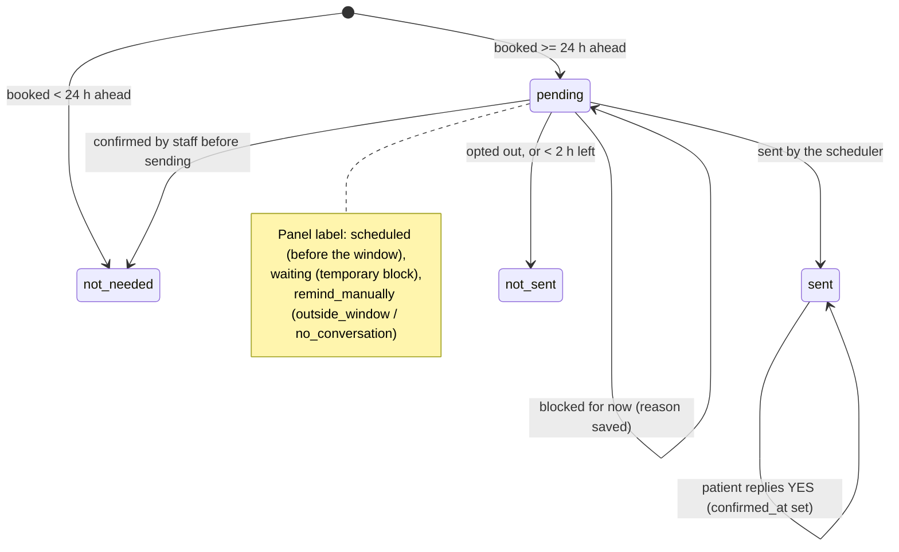

# Business rules

Rules the system enforces, grouped by domain. Numbers in parentheses are the defaults; the operator changes booking rules in the panel, and anti-ban and reminder limits are set through environment variables ([development](development.md#environment-variables)). Requirement IDs such as `FR-015` refer to the feature specs in [`specs/`](../specs).

## Conversations and the assistant

### BR-CNV-01 · Only one-to-one text messages get an answer
Audio, images, stickers and other media are stored and shown in the panel but never sent to the assistant. Group chats are ignored.
- **Where:** [evolution.ts](../src/modules/whatsapp/evolution.ts) (`parseEvolutionEvent`); [evolution-webhook.ts](../src/routes/evolution-webhook.ts)

### BR-CNV-02 · Each WhatsApp event is recorded and answered once
The same event delivered twice, even after a restart, is stored once and answered once.
- **Where:** unique `messages.wa_message_id`, insert with `on conflict do nothing` in [inbox/repository.ts](../src/modules/inbox/repository.ts)

### BR-CNV-03 · Consecutive messages get one reply
The assistant waits for 4 s of silence (`ANTIBAN_DEBOUNCE_MS`) and answers everything the patient sent since its last reply in one go.
- **Where:** [debounce.ts](../src/modules/antiban/debounce.ts), `debouncer` in [evolution-webhook.ts](../src/routes/evolution-webhook.ts)

### BR-CNV-04 · A message goes to scheduling or to the brochure
Every message is interpreted first. Booking-related intents (book, availability, cancel, reschedule, my appointment) and any message during a scheduling session go to scheduling; the rest goes to the brochure (RAG). A brochure question in the middle of a booking is still answered by the brochure.
- **Where:** [router.ts](../src/modules/scheduling/router.ts); detail in [message pipeline](message-pipeline.md)

### BR-CNV-05 · Brochure answers are short and honest
At most 3 messages per reply, split by paragraph (or by sentence when one long block). When the brochure doesn't have the answer, the assistant says "I don't have that information right now." instead of guessing. The assistant always writes in English.
- **Where:** `splitReply` and `MAX_PARTS` in [handle-message.ts](../src/modules/whatsapp/handle-message.ts); `NO_ANSWER` and the system prompt in [rag/assistant/pipeline.py](../rag/assistant/pipeline.py)

### BR-CNV-06 · The operator takes over a conversation by writing in it
Sending a message from the panel pauses the assistant in that conversation and cancels any reply it was about to send. It stays silent until the operator clicks **Resume**. Pause is checked before the assistant thinks and again right before sending.
- **Where:** `cancelPendingReply` in [evolution-webhook.ts](../src/routes/evolution-webhook.ts); `isPaused` checks in [handle-message.ts](../src/modules/whatsapp/handle-message.ts); `superseded` in [gate.ts](../src/modules/antiban/gate.ts)

### BR-CNV-07 · When the assistant is down, the patient is told once
If the RAG service fails or exceeds `RAG_TIMEOUT_MS` (30 s), the patient gets a short "unavailable" message (one of several variants, never the same one twice in a row). If the interpreter (Ollama) fails outside a booking, the message goes to the brochure; inside a booking, the patient gets the unavailable message.
- **Where:** `createRagAnswerer` in [handle-message.ts](../src/modules/whatsapp/handle-message.ts); `InterpreterUnavailable` in [router.ts](../src/modules/scheduling/router.ts)

### BR-CNV-08 · Disconnecting the number deletes every conversation
When WhatsApp logs the number out, all conversations and messages are deleted. The operator can also delete them all from the panel. Appointments, the customer registry and opt-outs survive both.
- **Where:** `loggedOut` branch in [evolution-webhook.ts](../src/routes/evolution-webhook.ts); `DELETE /api/conversations` in [panel-api.ts](../src/routes/panel-api.ts)

## Scheduling

Booking rules are stored in `scheduling_rules` and edited in the panel (**Calendar**). Defaults: Monday to Friday 09:00–18:00, 60-minute appointments, 2 h minimum notice, 30 days ahead, cancel or reschedule up to 24 h before.

### BR-SCH-01 · Free times come from the rules and the calendar
A time is offered only if it falls within that weekday's opening hours, on a step equal to the appointment length, after the minimum notice, within the days-ahead limit, and doesn't overlap **any** busy event on the selected Google Calendar (not just Secretaryfy's own).
- **Where:** `slotsForDay`, `bookingWindow` in [availability.ts](../src/modules/scheduling/availability.ts)
- **Validation of the rules:** at least one open day; start before end; length 15–240 min in multiples of 5; each open day at least one appointment long. `rulesSchema` in [rules.ts](../src/modules/scheduling/rules.ts)

### BR-SCH-02 · Options are numbered, at most 6 per message
Days and times are offered as numbered lists of up to 6; "more" shows the next page.
- **Where:** `PAGE` in [flow.ts](../src/modules/scheduling/flow.ts)

### BR-SCH-03 · Nothing is booked without "yes"
The assistant shows a summary (day, time, name, service) and books only after the patient confirms.
- **Where:** step `confirm_booking` in [flow.ts](../src/modules/scheduling/flow.ts)

### BR-SCH-04 · Two patients never get the same time
Right before writing, the calendar is read again inside a process-wide lock; a unique index on `(calendar_id, starts_at)` for booked appointments is the second barrier. If the index rejects the insert, the Google event just created is deleted. If the time was taken, the patient (or operator) gets other options.
- **Where:** `bookSlot` in [booking.ts](../src/modules/scheduling/booking.ts); `withCalendarLock` in [lock.ts](../src/modules/scheduling/lock.ts); `appointments_booked_start_uq` in [schema.ts](../src/db/schema.ts)

### BR-SCH-05 · One upcoming appointment per phone number
A phone with a future appointment can't book a second one; the assistant offers to reschedule instead, and the panel returns `already_booked`. The appointment belongs to the phone, not to the conversation ([ADR 0006](decisions/0006-appointment-belongs-to-phone.md)).
- **Where:** `findFutureBooked` in [sessions.ts](../src/modules/scheduling/sessions.ts), used by `bookSlot` in [booking.ts](../src/modules/scheduling/booking.ts)

### BR-SCH-06 · Cancel and reschedule only until the cancellation notice
Within `cancelNoticeMinutes` (24 h) of the appointment, the assistant refuses to cancel or move it and tells the patient the deadline.
- **Where:** `tooLate` in [flow.ts](../src/modules/scheduling/flow.ts)

### BR-SCH-07 · Google Calendar is the source of truth
Before using a stored appointment, it is compared with Google: deleted there means cancelled (with a 📅 note), moved there means the new time is adopted and the reminder recalculated.
- **Where:** `syncAppointment` in [booking.ts](../src/modules/scheduling/booking.ts)

### BR-SCH-08 · A booking dialogue expires after 30 minutes
A scheduling session expires 30 min after the last message. When the patient returns, the booking restarts from the day choice and availability is read again.
- **Where:** `SESSION_TTL_MS` in [sessions.ts](../src/modules/scheduling/sessions.ts)

### BR-SCH-09 · After 2 misunderstood replies, staff take over
On the second consecutive reply the assistant can't understand inside a booking, it tells the patient someone will help, pauses itself in that conversation and flags it **Needs attention**.
- **Where:** `MAX_MISUNDERSTOOD` and `misunderstood()` in [flow.ts](../src/modules/scheduling/flow.ts)

### BR-SCH-10 · The service is the last treatment mentioned
The appointment's service is the treatment the patient mentioned last in the conversation. If none, the assistant lists the 8 brochure treatments plus "Not sure — general assessment" (`Assessment`). The patient can change it at the summary.
- **Where:** `SERVICES`, `detectService` in [services.ts](../src/modules/scheduling/services.ts)

### BR-SCH-11 · What the calendar event looks like
Title `"<name> — <service>"` (e.g. "Maria Souza — Dental Cleaning"); the description holds the WhatsApp number and "Marcado pelo Secretaryfy." (or "Marcado pelo Secretaryfy (painel)." for panel bookings). Every booking, cancellation and reschedule is also written as a 📅 system note in the conversation history.
- **Where:** `bookSlot` in [booking.ts](../src/modules/scheduling/booking.ts); `systemNotes` in [replies.ts](../src/modules/scheduling/replies.ts)

### BR-SCH-12 · Panel bookings use the same engine and send nothing
A booking made by staff runs the same checks as the assistant (rules, free times, lock, one per phone) and sends no WhatsApp message. The phone typed in the panel is normalized: digits only, leading zeros removed, `55` added to 10–11 digit numbers; 12–15 digits are accepted as-is.
- **Where:** `bookSlot` in [booking.ts](../src/modules/scheduling/booking.ts); `normalizePhone` in [phone.ts](../src/modules/scheduling/phone.ts)

> ⚠️ Known limitation: the `+` is dropped before counting, so any 10–11 digit input is read as Brazilian. A US or Canadian number (`+1` plus 10 digits, 11 digits in total) becomes `551…` and can't be booked from the panel. Other countries with 12–15 digits work. See [phone.test.ts](../src/modules/scheduling/phone.test.ts).

## Names and customer registry

### BR-NAM-01 · The assistant asks for the name once
On its first reply to a patient with no known name, the assistant adds a request for the name, only once per conversation (`name_asked_at`). The next message alone can be read as the name.
- **Where:** `fromBrochure` and `awaitingName` in [router.ts](../src/modules/scheduling/router.ts)

### BR-NAM-02 · The WhatsApp profile name is never the patient's name
The known name is the name said in the chat (`conversations.customer_name`), or else the registry name. The profile name is only a label in the panel.
- **Where:** `knownName` in [inbox/service.ts](../src/modules/inbox/service.ts)

### BR-NAM-03 · Confirming a booking registers the customer
A successful booking upserts the customer by phone (one record per phone) and links the appointment to it. The registry has no foreign key to conversations, so it survives deleting conversations or disconnecting the number; a returning patient is recognized by name.
- **Where:** `bookSlot` in [booking.ts](../src/modules/scheduling/booking.ts); `upsert` in [customers/repository.ts](../src/modules/customers/repository.ts)

### BR-NAM-04 · Editing a name updates everything ahead
Renaming a customer in the panel (1–120 characters, trimmed) also renames the conversation, future appointments and the titles of future Google events. If Google fails, the name is saved anyway and the panel warns that the calendar wasn't updated. Past events keep their title.
- **Where:** `PATCH /api/customers/:id` in [panel-customers.ts](../src/routes/panel-customers.ts)

### BR-NAM-05 · Notes are private to the clinic
Customer notes (up to 1,000 characters) appear only in the panel. They never reach the assistant: not the interpreter, not the RAG history, not the known name.
- **Where:** `customers.notes` in [schema.ts](../src/db/schema.ts); validation in [panel-customers.ts](../src/routes/panel-customers.ts)

### BR-NAM-06 · Deleting a customer makes the assistant forget the name
Deleting a record also clears the name from that phone's conversation, so the assistant asks again. Appointments stay on Google Calendar; if the patient books again, they return to the registry.
- **Where:** `DELETE /api/customers/:id` in [panel-customers.ts](../src/routes/panel-customers.ts)

## Reminders

### BR-REM-01 · One reminder per appointment, 24 h to 2 h before
An appointment booked at least 24 h ahead (`REMINDER_LEAD_MINUTES`) gets one reminder, sent between 24 h and 2 h (`REMINDER_CUTOFF_MINUTES`) before it. Appointments booked closer than that get none. Rescheduling recalculates it.
- **Where:** `initialReminderStatus` in [status.ts](../src/modules/reminders/status.ts); [scheduler.ts](../src/modules/reminders/scheduler.ts)

### BR-REM-02 · The reminder never breaks the 24 h window
The reminder goes out only if the patient wrote in the last 24 h. Otherwise, and when the phone has no conversation at all, it shows **Remind manually** in the panel so staff can call and click **Confirm** ([ADR 0008](decisions/0008-reminder-only-inside-24h-window.md)).
- **Where:** `remind()` in [scheduler.ts](../src/modules/reminders/scheduler.ts); `reminderLabel` in [status.ts](../src/modules/reminders/status.ts)

### BR-REM-03 · The reminder passes the anti-ban gate
It's an ordinary assistant message: all [anti-ban rules](#anti-ban-protection) apply. A patient who opted out never gets it (status `not_sent`); a temporary block (paused, limit) makes it wait and retry. It also waits while the patient has an unanswered message or a booking dialogue is open. If 2 h before the appointment it still hasn't gone out, it's marked `not_sent` with the last reason.
- **Where:** `assistantBlockReason` in [gate.ts](../src/modules/antiban/gate.ts); [scheduler.ts](../src/modules/reminders/scheduler.ts)

### BR-REM-04 · YES confirms, NO offers to reschedule
Right after a reminder (no booking dialogue open, at most one patient message since), YES or phrases like "see you then" confirm the appointment; NO starts the reschedule offer. Staff can also confirm from the panel.
- **Where:** `awaitingReminder` in [router.ts](../src/modules/scheduling/router.ts); `ATTENDING` in [interpret.ts](../src/modules/scheduling/interpret.ts); `POST /api/appointments/:id/confirm` in [panel-appointments.ts](../src/routes/panel-appointments.ts)

### Reminder states

Confirmation is separate from the reminder state: `confirmed_at` and `confirmed_by` (`customer` or `operator`) are set by YES or by **Confirm**, and the panel shows **confirmed** above any reminder label.

## Anti-ban protection

The number is connected like WhatsApp Web, which WhatsApp's terms don't allow for automation. These rules reduce the ban risk; they can't remove it. All of them live behind one gate ([ADR 0003](decisions/0003-single-send-gate.md)). Assistant messages must pass the rules below, checked in this order; operator messages only wait for their turn in the queue (the operator confirms risks instead, BR-AB-08).

### BR-AB-01 · Human pacing
The patient's messages are marked as read 2–8 s after the last one, then a 1–3 s pause, then "typing…" for 2–12 s proportional to the reply length, with random variation. Consecutive sends are spaced 2–6 s.
- **Where:** [typing.ts](../src/modules/antiban/typing.ts); `readThenPause` in [gate.ts](../src/modules/antiban/gate.ts)

### BR-AB-02 · Volume limits
At most 8 messages per minute and 200 per hour from the number (assistant + operator), and 150 different conversations served by the assistant per 24 h. A reply waiting in the queue for more than 5 min is dropped. Counts come from the database, so a restart doesn't reset them.
- **Where:** `waitForSlot` and rule `daily_conversations` in [gate.ts](../src/modules/antiban/gate.ts); [queue.ts](../src/modules/antiban/queue.ts)

### BR-AB-03 · Never write first (24 h window)
The assistant never writes to a patient whose last message is older than 24 h, or who never wrote. Rule `outside_window`.
- **Where:** `isCold` in [gate.ts](../src/modules/antiban/gate.ts)

### BR-AB-04 · No insisting, no loops, no repeats
- At most 3 assistant messages in a row without a patient reply (`unanswered`).
- A conversation that looks like a loop with another bot (5 replies under 3 s each, or 20 assistant messages in 10 min) is blocked, paused and flagged (`loop`).
- The same text is never sent twice to the same patient within 30 min (`duplicate`); fixed texts rotate through variants.
- **Where:** [assess.ts](../src/modules/antiban/assess.ts); `pickVariant` in [gate.ts](../src/modules/antiban/gate.ts); variants in [texts.ts](../src/modules/antiban/texts.ts)

### BR-AB-05 · Opt-out and opt-in
A message that is exactly "stop", "parar", "sair", "unsubscribe" and similar (case, accents and punctuation ignored) silences the assistant for that phone, with one confirmation. "start", "voltar" and similar, or the operator, turn it back on. "cancelar" alone during a booking dialogue means cancelling the booking, not opting out. Opt-outs are stored by phone and survive disconnection.
- **Where:** `OPT_OUT`, `OPT_IN`, `matchCommand` in [opt-out.ts](../src/modules/antiban/opt-out.ts); `contact_preferences` in [schema.ts](../src/db/schema.ts)

### BR-AB-06 · No links in the first reply
All links are removed from the assistant's first reply to a patient; later replies may only link to domains in `ANTIBAN_ALLOWED_LINK_DOMAINS`. Removed links become "(link removed)".
- **Where:** `stripLinks` in [links.ts](../src/modules/antiban/links.ts)

### BR-AB-07 · Warm-up and automatic brake
- A number connected for the first time has lower limits for 14 days: 30 conversations per day and 4 messages per minute.
- 5 send failures in 10 min, or 3 connection drops in 30 min, pause all automated sends for 30 min, with a banner in the panel and affected conversations flagged.
- At most 5 QR code requests per 10 min.
- **Where:** `warmupLimits` in [limits.ts](../src/modules/antiban/limits.ts); [breaker.ts](../src/modules/antiban/breaker.ts); [instance.ts](../src/modules/whatsapp/instance.ts)

### BR-AB-08 · The operator confirms risky sends
Before an operator message goes out to a patient outside the 24 h window, to an opted-out patient, or while the brake is on, the panel asks for confirmation (`409 risk_confirmation_required`). A failed operator message can be retried, at most once every 30 s.
- **Where:** `operatorRisks` in [gate.ts](../src/modules/antiban/gate.ts); `retry` in [inbox/service.ts](../src/modules/inbox/service.ts); [RiskDialog.tsx](../web/src/components/RiskDialog.tsx)

### BR-AB-09 · Replies queued at shutdown are not sent after a restart
Assistant messages still in `sending` when the server stopped are marked `blocked` (`restart`) at startup.
- **Where:** `blockOrphanSending` call in [index.ts](../src/index.ts)

Every message the gate refuses is stored with status `blocked` and the reason, and shown in the panel.

## Panel access

### BR-PNL-01 · One shared password
The panel is off unless `OPERATOR_PASSWORD` (12+ characters) is set. A login creates a signed, HTTP-only, same-site cookie valid for 12 h. 5 wrong passwords from the same IP block it for 15 min.
- **Where:** [session.ts](../src/modules/auth/session.ts), [login-limiter.ts](../src/modules/auth/login-limiter.ts), [panel-session.ts](../src/routes/panel-session.ts)

## Inconsistencies found

- `package.json` still describes the project as an assistant "for sending emails"; no email feature exists.
- `ANTHROPIC_API_KEY` is required by [env.ts](../src/config/env.ts), but no code calls the Claude API.
- The service catalog exists twice: `SERVICES` in [services.ts](../src/modules/scheduling/services.ts) and a hard-coded copy in [NewAppointment.tsx](../web/src/components/NewAppointment.tsx). Changing one without the other makes the panel offer a service the API rejects, or hide one the assistant books.
- The comment on `DELETE /api/conversations` in [panel-api.ts](../src/routes/panel-api.ts) says it deletes "appointments in progress". It deletes scheduling sessions (dialogues in progress), not appointments, which survive since feature 006.
