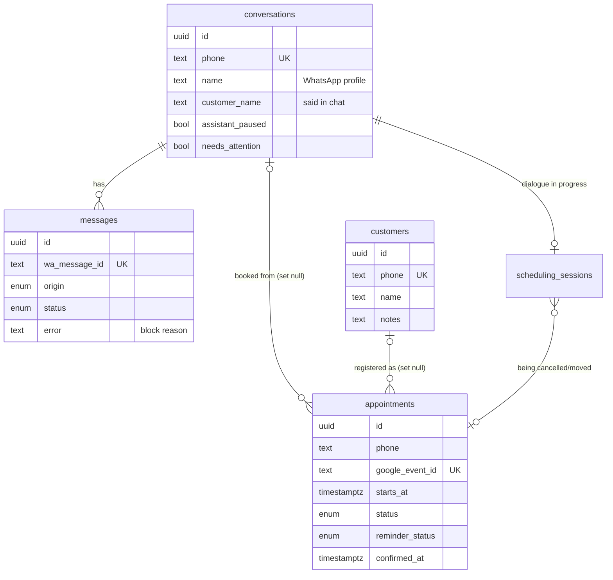

# Data model

**Database:** PostgreSQL 17 (Docker, host port 5434) · **Schema source:** [src/db/schema.ts](../src/db/schema.ts) · **Migrations:** [drizzle/](../drizzle), generated with `npm run db:generate`

The Evolution API keeps its own data in the same database, in the `evolution_api` schema. Secretaryfy never reads it.

## Diagram

Single-row and standalone tables: `calendar_connection`, `scheduling_rules`, `protection_state` (one row each, enforced by a `check (id = 1)`), `contact_preferences` and `connected_numbers` (keyed by phone/number, no foreign keys).

The **phone number** (digits with country code, as WhatsApp sends it, e.g. `5571999999999`) is the real key across tables. `customers`, `appointments`, `contact_preferences` deliberately have no foreign key to `conversations`, so they survive deleting conversations or disconnecting the number ([ADR 0006](decisions/0006-appointment-belongs-to-phone.md)).

## Entities

### conversations
One per phone number.

| Field | Meaning |
|---|---|
| `name` | WhatsApp profile name. Only a label; never the patient's name ([BR-NAM-02](business-rules.md#br-nam-02--the-whatsapp-profile-name-is-never-the-patients-name)) |
| `customer_name` | Name the patient said in the chat |
| `name_asked_at` | When the assistant asked for the name; it never asks twice |
| `assistant_paused` | The assistant stays silent here until the operator resumes |
| `needs_attention` | Flagged for staff (hand-off, loop, limit) |
| `unread_count`, `last_message_*` | Panel list |

### messages
Every individual message sent or received by the connected number, plus internal notes.

| Field | Meaning |
|---|---|
| `origin` | `customer`, `assistant`, `operator` (panel), `phone` (clinic's own phone app), `system` (note in the history, never sent) |
| `status` | `received`, `sending`, `sent`, `failed`, `blocked` |
| `wa_message_id` | WhatsApp id, unique; null only while `sending`. Makes webhook delivery idempotent |
| `error` | Failure message, or the gate's block reason when `blocked` (`outside_window`, `duplicate`, `restart`…) |
| `sent_at` | WhatsApp time (seconds); `created_at` breaks ties |

### customers
The registry: everyone who confirmed a booking ([names and customers](business-rules.md#names-and-customer-registry)). `phone` is unique; `notes` is staff-only.

### appointments
Appointments made by the assistant or the panel. Google Calendar is the source of truth; this table is the local copy used for rules, reminders and the panel ([ADR 0005](decisions/0005-google-calendar-source-of-truth.md)).

| Field | Meaning |
|---|---|
| `phone` | Owner of the appointment; one future booked appointment per phone |
| `conversation_id` | Where it was booked; set to null if the conversation is deleted |
| `origin` | `assistant` or `panel` |
| `google_event_id`, `calendar_id` | The Google event |
| `customer_name`, `service` | As in the event title. `service` is null for appointments before feature 005 |
| `customer_id` | Registry record, set to null if the record is deleted |
| `status`, `cancelled_by` | `booked` or `cancelled`; cancelled by `customer` or `calendar` (deleted in Google) |
| `reminder_status`, `reminder_reason`, `reminder_sent_at` | See [reminder states](business-rules.md#reminder-states) |
| `confirmed_at`, `confirmed_by` | Confirmed by `customer` (YES) or `operator` |

Unique partial index `appointments_booked_start_uq (calendar_id, starts_at) where status = 'booked'` is the database-level barrier against double booking ([BR-SCH-04](business-rules.md#br-sch-04--two-patients-never-get-the-same-time)).

### scheduling_sessions
At most one per conversation: the booking, cancel or reschedule dialogue in progress.

| Field | Meaning |
|---|---|
| `flow` | `book`, `cancel` or `reschedule` |
| `step` | `choose_day`, `choose_slot`, `ask_name`, `choose_service`, `confirm_booking`, `offer_reschedule`, `confirm_cancel`, `confirm_reschedule` ([diagram](message-pipeline.md#6b-scheduling-flow)) |
| `options` | The numbered options last shown: days, times or services |
| `selected_start`, `customer_name`, `service`, `appointment_id` | What's been chosen so far |
| `misunderstood_count` | Consecutive replies not understood; 2 hands over to staff |
| `expires_at` | 30 min after the last message |

### calendar_connection
The clinic's Google account and selected calendar: email, scopes, `refresh_token_enc` (AES-256-GCM, see [crypto.ts](../src/config/crypto.ts)), calendar id, name and time zone, and `status` (`connected` or `needs_reauth`). No row means disconnected.

### scheduling_rules
Opening hours per ISO weekday (`weekly_hours` JSON, `"1"` = Monday … `"7"` = Sunday; a missing day is closed), `slot_minutes`, `min_notice_minutes`, `max_days_ahead`, `cancel_notice_minutes`. Created with the defaults on first read ([rules.ts](../src/modules/scheduling/rules.ts)).

### Anti-ban tables
- `contact_preferences`: `phone`, `opted_out_at`. Opt-out by phone, survives disconnection.
- `connected_numbers`: every number ever connected, with `first_connected_at` (starts the 14-day warm-up).
- `protection_state`: the automatic brake: `paused_until` and `reason` (`send_failures` or `connection_drops`).

Send counts for the limits are read from `messages` (index `messages_outgoing_sent_at_idx`), not kept in a separate table.

## Lifecycle and deletion

| Action | Deletes | Keeps |
|---|---|---|
| Number logged out / "Delete all conversations" | conversations, messages, scheduling sessions | appointments (conversation link nulled), customers, opt-outs, connected numbers |
| Delete a customer | the customer row; the conversation's `customer_name` | appointments (customer link nulled) and Google events |
| Appointment deleted in Google | — (marked `cancelled` / `calendar` on next sync) | the row |

## Data protection

Messages, names, phone numbers and notes are personal data (LGPD). There is no retention policy or automatic purge; data stays until the number is disconnected or staff delete it. The Google refresh token is the only value encrypted at rest. See the [open questions](README.md#open-questions).
