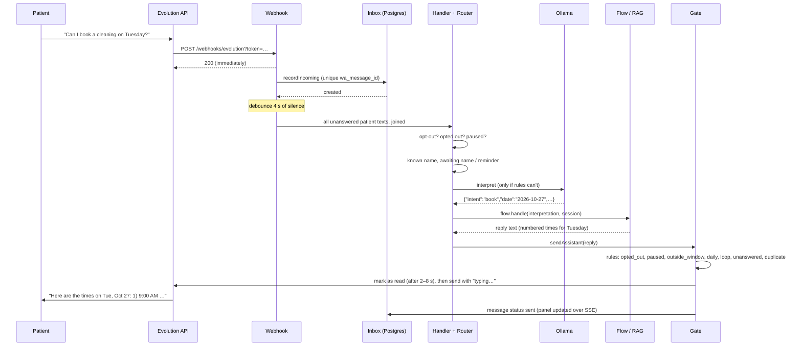
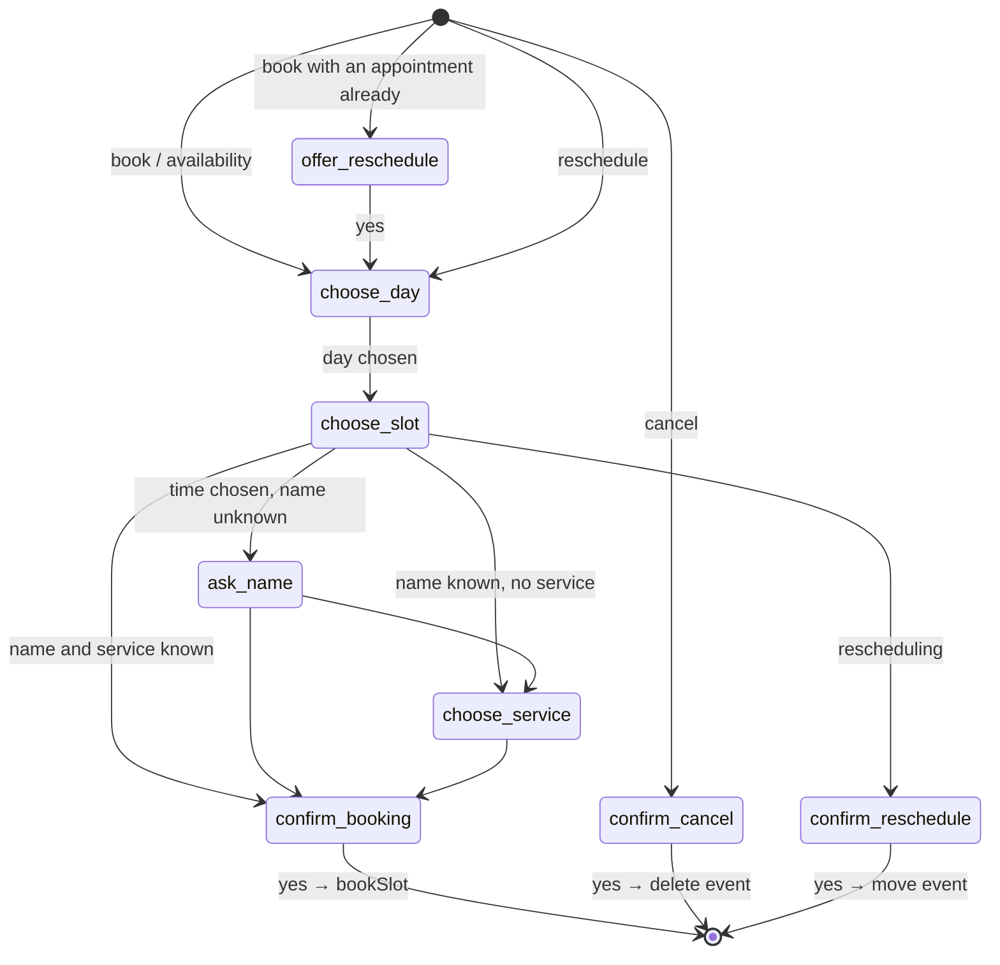

# Message pipeline

Everything Secretaryfy does for a patient starts with a WhatsApp message and ends with a reply that passed the anti-ban gate. This page follows one message through the system. The rules applied along the way are in [business rules](business-rules.md); this page shows where they happen.

## Overview

| Stage | What happens | Code |
|---|---|---|
| 1. Webhook | Authenticate, parse, answer 200 at once | [evolution-webhook.ts](../src/routes/evolution-webhook.ts), [evolution.ts](../src/modules/whatsapp/evolution.ts) |
| 2. Record | Store the message once, update the conversation, notify the panel | [inbox/service.ts](../src/modules/inbox/service.ts) |
| 3. Debounce | Wait for 4 s of silence, join the patient's unanswered messages | [debounce.ts](../src/modules/antiban/debounce.ts) |
| 4. Handle | Opt-out/opt-in, paused conversation, then ask for a reply | [handle-message.ts](../src/modules/whatsapp/handle-message.ts) |
| 5. Route | Known name, reminder answer, interpret, then scheduling or brochure | [router.ts](../src/modules/scheduling/router.ts) |
| 6a. Interpret | Rules first; the model only when rules can't decide | [interpret.ts](../src/modules/scheduling/interpret.ts), [ollama.ts](../src/modules/scheduling/ollama.ts) |
| 6b. Scheduling | State machine decides the next step and writes the reply | [flow.ts](../src/modules/scheduling/flow.ts), [booking.ts](../src/modules/scheduling/booking.ts), [replies.ts](../src/modules/scheduling/replies.ts) |
| 6c. Brochure | RAG service answers from the clinic's PDF | [rag/client.ts](../src/modules/rag/client.ts), [rag/server.py](../rag/server.py) |
| 7. Gate | Anti-ban rules, read receipt, typing, queue, send | [gate.ts](../src/modules/antiban/gate.ts) |

## End to end

### 1. Webhook
`POST /webhooks/evolution?token=…` checks the token in constant time and parses the event with `parseEvolutionEvent`. Groups, reactions and addresses without a phone are dropped (and logged). The route always answers 200 right away so the Evolution API doesn't resend; everything else runs in the background. Connection events update the instance state, count connection drops for the breaker, register the number for warm-up, or, on logout, delete all conversations.

### 2. Record
`inbox.recordIncoming` inserts the message with `on conflict (wa_message_id) do nothing`. A repeated event returns `created: false` and stops here, which makes the whole pipeline idempotent. Messages sent from the clinic's own phone (`fromMe`) are recorded with origin `phone` and never answered. Media is recorded but not answered. The panel gets `message.created` and `conversation.updated` over SSE.

### 3. Debounce
Opt-out/opt-in commands skip the wait and are handled immediately. Other texts restart a 4 s timer per conversation. When it fires, the handler gets all patient texts since the assistant's last reply, joined with newlines, as one message. A map of "last message answered" per conversation stops a second timer from answering the same messages twice. An operator message cancels the pending timer (`cancelPendingReply`).

### 4. Handle
`createMessageHandler` runs, in order:
1. Opt-out/opt-in command (exact phrase match, no model): store the preference and send one confirmation.
2. Opted-out patient: no reply; the message stays visible in the panel.
3. Paused conversation: no reply.
4. Ask the router for a reply.
5. Check the pause again (the operator may have taken over while the model was thinking).
6. Split brochure answers into up to 3 messages and drop parts the patient just received. A follow-up (the name request) goes last.
7. Send each part through the gate. If one doesn't go out, the rest are dropped.

### 5. Route
`createSchedulingRouter` prepares the context:
- the active scheduling session (if any), the calendar's time zone and the booking window from the rules;
- the last 20 messages as history (the current one removed);
- the **known name**: copied from the customer registry into the conversation on a returning patient's first message;
- `awaitingName`: the name was asked and this is the first message since;
- `awaitingReminder`: no session, the phone's next appointment had a reminder sent, and the patient sent at most one message since.

Then it interprets the message and decides:
- `goodbye` → a goodbye, or ends the session in progress.
- Reminder answer → `yes` confirms the appointment and replies; `no` becomes `book`, which offers a reschedule.
- A name given → saved on the conversation.
- During a session, anything but a `question` goes to the flow. Without a session, only `book`, `availability`, `cancel`, `reschedule` and `my_appointment` start one. Everything else goes to the brochure, which adds the one-time name request to unknown patients.
- The service for a new booking is the last treatment mentioned in the patient's messages.

### 6a. Interpret
The interpreter tries deterministic rules first: option numbers, yes/no words, "more", "other day", simple dates ("tuesday", "27th", "10/27"), times, closings ("thanks, bye"), names ("my name is…", or a bare name when `awaitingName`), service numbers and words, reminder answers. Only when no rule applies does it call Ollama's `/api/chat` with `temperature: 0`, the step, the offered options, the history and a JSON Schema for the output, and validate the result with zod. `source: "rule" | "model"` is logged with the latency. Ollama failing or timing out (20 s) raises `InterpreterUnavailable` ([BR-CNV-07](business-rules.md#br-cnv-07--when-the-assistant-is-down-the-patient-is-told-once)).

This split is why a small 8B model is enough: most turns never reach it, and when it runs it only has to label the message, not decide anything ([ADR 0002](decisions/0002-state-machine-with-local-llm-as-interpreter.md)).

### 6b. Scheduling flow
`flow.handle` is a state machine over the session step:

Each step's options are stored in `scheduling_sessions`, so "2" means the second option actually shown. Free times come from [availability.ts](../src/modules/scheduling/availability.ts) and Google's free/busy. Writes to the calendar go through the lock and the booking engine ([architecture](architecture.md#main-flows)). Every reply text comes from [replies.ts](../src/modules/scheduling/replies.ts), never from the model. Results are logged in the conversation as system notes (📅).

### 6c. Brochure (RAG)
[rag/client.ts](../src/modules/rag/client.ts) posts `{question, history}` (last 6 turns) to the Python service, with a 30 s timeout. The service ([rag/server.py](../rag/server.py), [retrieval/pipeline.py](../rag/assistant/retrieval/pipeline.py)) rewrites a follow-up into a standalone question, searches the brochure with the `section_hybrid` experiment (vector search + BM25 merged by reciprocal rank fusion over section-sized chunks), and asks `llama3` to answer only from those chunks, or with the fixed "I don't have that information right now." It refuses to start with an outdated index. Details: [rag/README.md](../rag/README.md).

### 7. Gate
`gate.sendAssistant` is the only way an assistant message reaches WhatsApp ([ADR 0003](decisions/0003-single-send-gate.md)):
1. Check the rules in order; the first match blocks the message, stores it as `blocked` with the reason, and for some reasons flags the conversation.
2. Wait until 2–8 s after the patient's last message, mark their messages as read, pause 1–3 s.
3. Strip links (all of them in the first reply).
4. Store the message as `sending` and enqueue it. The queue sends one message at a time, inside the per-minute/per-hour limits, with a random 2–6 s gap. Before sending, it rechecks the breaker, the pause, and whether the operator wrote in the meantime (`superseded`).
5. Send with a "typing…" delay proportional to the length; mark `sent` with the WhatsApp id, or `failed` and count a failure for the breaker.

The Evolution API then echoes the sent message back through the webhook; the unique WhatsApp id makes the echo a no-op.

## Edge cases

| Situation | What happens | Where |
|---|---|---|
| Same event delivered twice | Stored and answered once | unique `wa_message_id` |
| Patient sends 3 messages quickly | One reply to all three | debouncer |
| Operator writes while the assistant is thinking | Assistant's reply is dropped (`superseded`) | handler pause re-check; queue `check` |
| Server restarts with replies in the queue | Marked `blocked` / `restart`, not sent later | `blockOrphanSending` in [index.ts](../src/index.ts) |
| RAG times out | "Unavailable" message, never the late answer | [rag/client.ts](../src/modules/rag/client.ts) aborts the request |
| Ollama down, no session | Message goes to the brochure | [router.ts](../src/modules/scheduling/router.ts) |
| Time taken between offer and "yes" | Other times offered | `bookSlot` re-check and unique index |
| Event deleted or moved in Google | Treated as cancelled or moved next time it's read | `syncAppointment` |
| Patient disappears mid-booking | Session expires in 30 min; restart from the day | `SESSION_TTL_MS` |
| Another bot answers in a loop | Blocked, conversation paused and flagged | `assessConversation` |
| "cancelar" during a booking | Treated as cancelling the booking, not opting out | `matchCommand` |

## How to verify

- `npm test`: unit and integration tests of every stage, with PGlite and a fake calendar (router, flow, gate, handler, webhook).
- `npx tsx --env-file=.env scripts/eval-scheduling.ts`: 23 scripted booking conversations against the **real** local model and a fake calendar; reports per-criterion results and latency (last run: 23/23).
- `npx tsx --env-file=.env scripts/simulate-customer.ts "I'd like to book an appointment"`: posts a message to the webhook as if it came from your own number; the reply arrives in your WhatsApp "You" chat.
- Manual end-to-end scripts: [specs/003 quickstart](../specs/003-google-calendar-scheduling/quickstart.md), [specs/004 quickstart](../specs/004-whatsapp-anti-ban/quickstart.md), [specs/006 quickstart](../specs/006-panel-appointments-reminders/quickstart.md).

## See also

- Rules: [conversations](business-rules.md#conversations-and-the-assistant), [scheduling](business-rules.md#scheduling), [anti-ban](business-rules.md#anti-ban-protection)
- [ADR 0002](decisions/0002-state-machine-with-local-llm-as-interpreter.md), [ADR 0003](decisions/0003-single-send-gate.md)
- Contracts: [specs/003 interpreter](../specs/003-google-calendar-scheduling/contracts/interpreter.md), [specs/003 conversation](../specs/003-google-calendar-scheduling/contracts/conversation.md)
